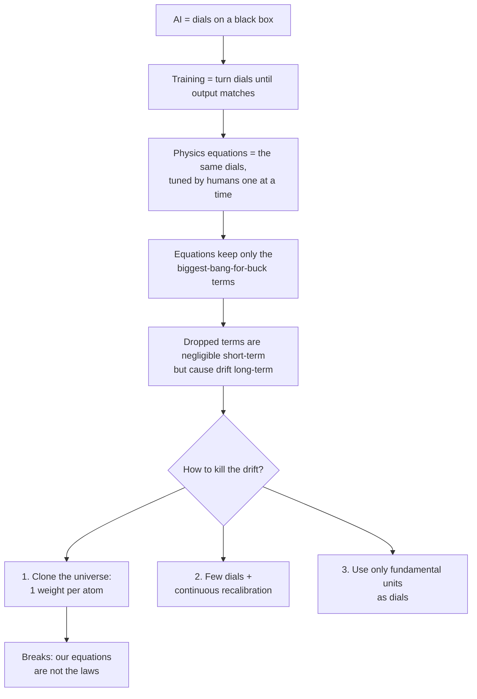

# Cloning the Universe for 100% Prediction

> Status: **Raw**. Logged to think harder later.

## The idea

To predict anything with 100% accuracy, a formula has to include *every* parameter. So the brute-force answer: clone the entire universe, give 1 weight to each atom, plus 1 extra weight for how they're arranged (exact coordinates), and run the copy.

It isn't infinite. Atoms are countable and finite (roughly 10⁸⁰ in the observable universe). Even if God ran a simulator, he'd pick a finite number, not an infinite one. It's only the *probability set of arrangements* that pushes things toward infinity.

## How it develops

**1. The dials analogy.** Give someone 3 dials on a black-box function and an output screen, and ask them to hit a target output. The smart way: hold 2 constant, turn 1, see how wildly the output changes, repeat. That's what AI training does at huge scale.
- *Correction:* real training doesn't go one dial at a time. Backpropagation uses the chain rule to get every dial's effect on the error in one pass, then nudges them all at once. One-at-a-time is coordinate descent / finite differences, the slow version.

**2. Physics and AI are the same thing.** Both are a finite set of dials approximating the universe. The only difference is where the dials come from:
- **Physics models** (supercomputer weather runs): dials are equations humans found by turning one variable at a time for ~300 years.
- **AI models** (Google's weather AI): dials are learned from data, automatically.

They fail differently on black swans, though. The AI only knows past data, so it smooths away events it's never seen. The physics model has no memory, only laws, so it *can* produce a never-seen event. But the supercomputer also only takes a limited number of inputs, so it fails too.

**The weather example, used as the argument:**
- **Google DeepMind's weather AI** (GraphCast / GenCast) is trained on decades of past weather data. It's fast and accurate, but it's still only linear algebra over a finite set of learned weights.
- **The supercomputer** (traditional numerical weather prediction) solves physics equations on a grid for hours, and it's credited with catching black-swan events the AI can miss.
- **But it's the same argument for both.** The supercomputer only takes a limited set of inputs out of everything that exists (finite stations, a finite grid, truncated equations), and simulates from those. So it has fewer parameters than the real atmosphere too, and it can fail on the same 8-hour run.
- **Conclusion:** neither is "the real thing". Both are limited-parameter copies of reality. Getting closer needs more inputs, and following that all the way leads to the idea: clone the universe, one weight per fundamental particle.

**3. Equations are "biggest bang for buck".** Every formula keeps the terms that matter most and drops the rest. The ideal gas law ignores molecule size and attraction. Fine short-term; over a long time frame the dropped terms show up as drift. Arguably everything couples to everything (pressure and friction *are* coupled in moving fluids through the Navier–Stokes equations), but coupling strengths differ by orders of magnitude, which is why truncation works.

**4. Three ways out of the drift:**
1. **Clone the universe** and run the copy.
2. **Calibrate continuously**: keep the cheap model and add a single weight that just tracks the error.
3. **Use only fundamental measurements as dials**, so derived units don't explode into infinite weights.

**5. Newcomb's problem as the test case.** A predictor that's 100% correct gives you box 1 ($1,000,000 or empty) and box 2 (guaranteed $1,000). If it predicts you'll take both, it empties box 1 before you walk in. To be 100% correct it probably cloned the universe, so the best strategy is to take 1 box: *what if you're the clone it's running?* Then your choice really does decide what's in the box.
- Expected value with even a 99% predictor: one box ≈ 0.99 × $1M ≈ $990,000; both boxes ≈ 0.01 × $1,001,000 + 0.99 × $1,000 ≈ $11,000.

## Where it breaks

**The real point: our equations are not the laws of physics.** The universe runs the real laws, exactly. We run our best fitted guess at them, checked only over the range we've tested. A clone built on our equations wouldn't reproduce reality. It would reproduce *our ignorance* at high resolution, and drift exactly at the edge cases we haven't found yet. History:
- **Newton's gravity:** perfect for ~200 years, until Mercury's orbit drifted by 43 arcseconds per century. General relativity fixed it.
- **Classical physics:** fine until blackbody radiation and the photoelectric effect. Quantum mechanics came out of those edge cases.
- **Ideal gas law:** fine until high pressure / low temperature.

The equations weren't wrong inside their range. The range was just smaller than anyone knew.

Even with the *true* laws, a perfect clone still fails:
- **Arrangements are uncountable, not just huge.** Atoms are finite, but positions are continuous. The infinity is in the state space, not the atom count.
- **Heisenberg:** Δx·Δp ≥ ħ/2, where Δx = position uncertainty (m), Δp = momentum uncertainty (kg·m/s), ħ ≈ 1.055×10⁻³⁴ J·s. Exact coordinates don't exist to be copied.
- **The super camera fails too.** Imagine a camera that snapshots the exact position of every atom in the universe at one instant. That's half of what the demon needs: positions alone don't say where anything is *going*, so you also need momentum. Heisenberg forbids having both. The sharper the position snapshot (Δx → 0), the larger the momentum uncertainty (Δp → ∞). Taking two snapshots and computing velocity from the difference doesn't save it either: the first precise snapshot disturbs the momentum, so the second one measures a different universe from the one you started with.
- **Chaos:** any rounding error in the copy grows exponentially.
- **Self-reference:** the simulator is inside the universe, so it would have to simulate itself simulating itself.

So option 2 (few dials + continuous recalibration) wins, and it isn't close.

## What it's secretly close to

- **Map vs territory** (Korzybski): the model isn't the thing.
- **"All models are wrong, but some are useful"** (George Box).
- **Hume's problem of induction:** no amount of past data proves the next case behaves the same.
- **Popper's falsifiability:** theories are never proven, only "not broken yet".
- **Laplace's demon:** the 1814 thought experiment of an intellect that knows every particle's position and momentum and so knows the future. Killed by quantum mechanics and chaos.
- **Data assimilation / Kalman filter:** option 2 exactly. Weather forecasting nudges the model toward millions of observations a day.
- **Digital twins:** the same pattern for machines.
- **Buckingham Pi theorem:** option 3. With n variables built from k base units, the physics depends on only n − k dimensionless groups (e.g. Reynolds number Re = ρvL/μ, where ρ = density, v = velocity, L = length, μ = dynamic viscosity).
- **Newcomb's paradox** (Nozick, 1969) and the "you might be the simulation" argument for one-boxing (Scott Aaronson).

## Think harder later

- [ ] Can you *detect* that you're near the edge of an equation's tested range before it fails? (Drift in the error weight as an early warning?)
- [ ] Is there a smallest set of fundamental dials that's complete, or does every new edge case add a dial?
- [ ] If a predictor only needs my *decision procedure* (not the universe), how small can that model be?
- [ ] Hybrid weather model: physics core + AI correction term. Does it get the best of both on black swans?
